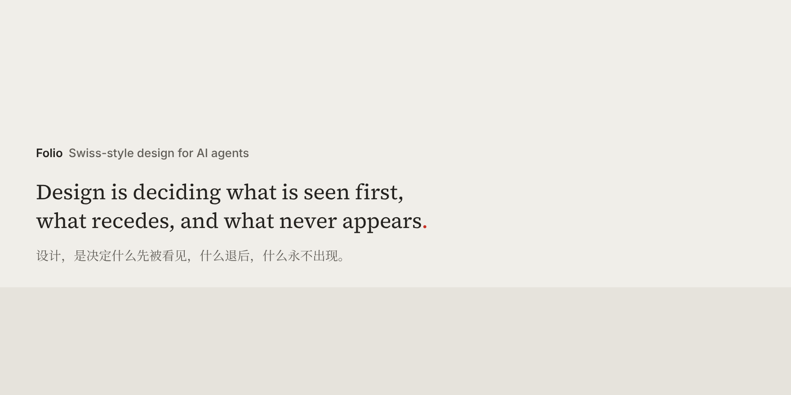
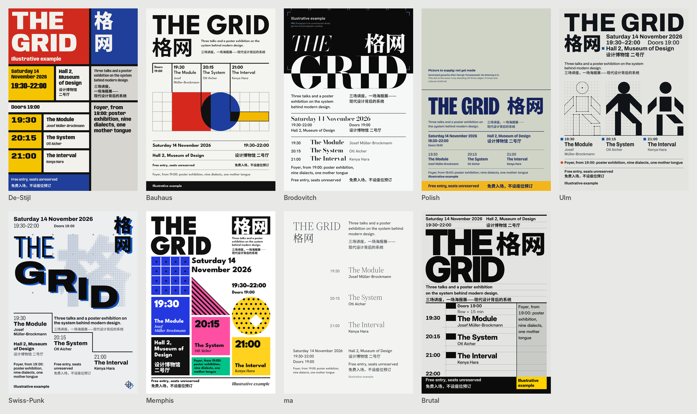

# Folio

**Master-level design for AI agents.** A skill that art-directs slides, posters, websites, canvases and handbooks in the hand of a named school, so they read as designed, not generated, and writes each world's aesthetic skeleton as a DESIGN.md.

[Install](#install) · [How it works](#how-it-works) · [Themes](#themes) · [中文](#中文)



## What changes

| Left to itself, a model reaches for | With Folio |
|---|---|
| A cream ground, black, one vermilion | Ground and accent from the hand and the subject |
| The subject's most literal pictogram | A structure found in the subject and built in code |
| A named style as costume | The master's way of working: first move, tools, material, procedure |
| Kickers, 01/02/03, mono labels, a navy closing slide | Hierarchy by type and scale; chrome only with a job |
| A rendered object standing in for material | Real material, or an honest placeholder |
| Grading its own work | Critics who did not make it, and a judge |

## How it works

- **The author's eye.** Thirteen lines of philosophy outrank everything else.
- **Names carry methods.** A master is summoned by name and practised by his way of working.
- **Routes, not steps.** SKILL.md says which file each moment opens, the theme before the first mark; the agent plans its own route.
- **A skeleton per world.** A DESIGN.md written for the agent that makes the next piece: method before look, values last, no content; another piece of the world can be made from it alone.
- **Floors by machine.** Facts verbatim, contrast, live text, the export against its tokens.
- **Tested against no skill.** Fixed briefs, a light maker, a blind judge. In 1.0, Folio placed first on all five briefs against 0.9.0 and no skill.

## Themes

A theme is a school with its masters, grammar and dialects; SKILL.md holds only what is true under every theme. The first theme is **[Swiss](references/themes/swiss/theme.md)**, the International Typographic Style. Alone it suits material that argues, reports, counts or lists; a dialect overturns a few Swiss rules across the whole work.

| Dialect | The material | Departs from Swiss |
|---|---|---|
| [De Stijl](references/themes/swiss/dialects/de-stijl.md) | Relates: proportion and balance are the subject | Black bars and primary planes in equilibrium |
| [Bauhaus](references/themes/swiss/dialects/bauhaus.md) | Celebrates or explains, where geometry can build the subject | Primaries and primitives assembled into figures |
| [Brodovitch](references/themes/swiss/dialects/brodovitch.md) | Seduces, where people or images are the subject | Black-and-white photographs under the subject's own colour; figure cut against the word |
| [Polish Poster School](references/themes/swiss/dialects/polish-poster.md) | Interprets a cultural subject | One authored, hand-made metaphor |
| [Ulm](references/themes/swiss/dialects/ulm.md) | Coordinates a system of messages | Rules for every case; color and pictograms as codes |
| [Swiss Punk](references/themes/swiss/dialects/swiss-punk.md) | Provokes, still readable | The grid tested by rotation, layering, stepped type |
| [Memphis](references/themes/swiss/dialects/memphis.md) | Delights | A field tiled whole with the subject's own kit, in clashing hues |
| [Kenya Hara, ma 間](references/themes/swiss/dialects/ma.md) | Invites: one object, craft or ceremony | Emptiness as the vessel |
| [Swiss Brutal](references/themes/swiss/dialects/brutalist.md) | Specifies: structure is the content | Visible grid rules, zero radius, dense rows |

## Install

Any agent that reads Agent Skills:

```
npx skills add yeweigao/folio
```

Claude Code, for every project:

```bash
git clone https://github.com/yeweigao/folio ~/.claude/skills/folio
```

Claude apps: zip the folder, then go to Customize → Skills → + → Upload a skill. Code execution must be on.

`render.py` needs Playwright; `contact.py` and `measure.py` need Pillow. Every other script uses only the Python standard library.

## Use

> Turn this report into a board deck.

> Make the poster series for our concert season.

> 这张海报太 AI 味了，重做一版，用 ma 間。

## Structure

```
SKILL.md          goal · philosophy · routes · themes (v1.1.0)
references/       design-md · review · tools · craft · signature · steering
  surfaces/       slides · poster · web · canvas · handbook
  themes/swiss/   theme · 9 dialects
scripts/          render · contact · factcheck · folio-check · preview · extract · measure · release-check · generators
examples/         nine standalone design systems · one series from one skeleton
tests/            fixed briefs for judging changes
CONTRIBUTING.md   laws, contracts and releases for changing the skill
```

## 中文

Folio 是给 AI agent 用的设计 skill,覆盖 PPT、海报、网页、画布和手册,以具名流派和大师的做法做出大师水准(第一个主题是瑞士风格及其周边的现代主义流派),并把每个世界的审美骨架写成一份 DESIGN.md。

- **作者的眼光**:13 条设计哲学凌驾一切。
- **名字带方法**:大师以名字召唤,以他的做法实践。
- **给路由,不给步骤**:什么情况打开哪个文件,动手前必读主题;路线由 agent 自己定。
- **骨架不含内容**:同一个世界的下一件作品,只凭骨架就能做出来。
- **底线由机器检查**:事实、对比度、活字。

## License

MIT. No fonts are bundled; each keeps its own license.
