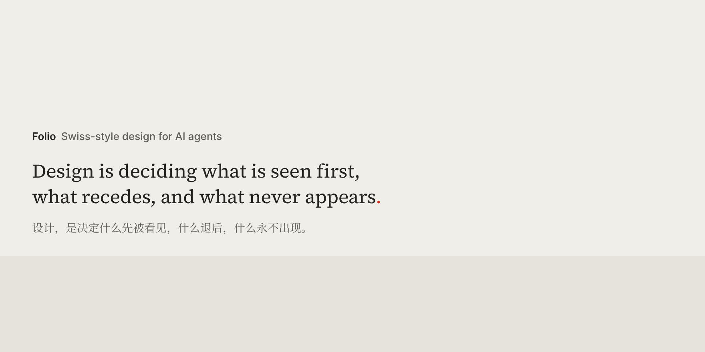

# Folio

**Swiss-style design for AI agents.** A skill that art-directs slides, posters, websites, canvases, and handbooks, so the result reads as designed rather than generated.

[Install](#install) · [How it works](#how-it-works) · [Dialects](#dialects) · [中文](#中文)

## What changes

Agents reach for the same moves. Folio names each one and gives the alternative.

| The default | With Folio |
|---|---|
| Centered hero, three equal cards, gradient button | A flush-left claim, one supporting line, one action |
| Floating rounded cards, shadows, glass | Grouping by space, rules, or one solid field |
| KPI tiles | A ledger: value, baseline, period, change |
| An icon per bullet, emoji | Hierarchy by type; one pictogram set where it speeds recognition |
| Pie, donut, gauge, dual axis | Sorted bars, labeled lines, aligned panels |
| Purple-blue gradients | Paper, ink, and one accent taken from the subject |
| Elevate, seamless, 赋能, 一站式 | The concrete action, object, and number |

## How it works

**Thirteen lines of philosophy.** `SKILL.md` changes the output on its own:

1. A unit has a lead, not a crowd.
2. The eye's path is designed, not discovered.
3. The decisive move comes from the subject, not from a style.
4. Layout serves the content, not the other way round.
5. Measure is shared, not improvised.
6. Space is placed, not left over.
7. Hierarchy is steps, not slopes.
8. Color is a role, not a decoration.
9. A deliverable has rhythm, not monotony.
10. Information is encoded, not decorated.
11. An image is information, not filler.
12. Style is a constraint system, not an element set.
13. The frame is composed, not inherited.

**A theme, not a template.** By default, the Swiss mother tongue (Müller-Brockmann, Ruder, Hofmann, *Neue Grafik*) holds the work together. A dialect is a named movement: its people, place, and period, and the three or four Swiss rules it overturns across the whole piece. Nine are in the library, from De Stijl to Swiss Brutal. The masters' moves inside Swiss, Crouwel's grid-built letters, Gerstner's programmes, Isotype rows, Vignelli's Unigrid, live in its methods. One of 21 variations breaks a rule where the content turns.

**Three directions, one locked file.** Before anything is rendered, Folio drafts three directions: the mother tongue by the book, the mother tongue pushed, and the closest dialect. It renders the hardest unit in each, in one image, and waits for a choice. The choice is locked in a [DESIGN.md](references/design-md.md), Google's open format plus every unit's form, lead, named methods, and variation, so later units, sessions, and helpers build from the same file.

**Forms and methods.** Each unit takes a form by its reader task. Read the theme's methods whole, then choose and combine them per unit within one system. Swiss crosses eight tasks with text, image, data, and space, drawing on Gestalt, Bertin's visual variables, and Gerstner's morphological box.

**Craft that holds up.** Grid, type, color with 20 named starting points, copy, data, and imagery, read whole for every task; data follows the reader's question, with consulting exhibits and IBCS as report conventions.

**Floors.** Facts stay exact. Normal text holds 4.5:1, verified large text 3:1, against its actual ground at viewing size. The final export is inspected; [SKILL.md](SKILL.md) and [craft](references/craft.md) hold the conditions.

## Dialects

The mother tongue alone suits material that argues, reports, testifies, surveys, counts, or lists; the closest dialect is still tested beside it.

| Dialect | The material | Departs from Swiss |
|---|---|---|
| [De Stijl](references/themes/swiss/dialects/de-stijl.md) | Relates: parts whose proportions and balance are the subject | Black bars and primary planes in equilibrium |
| [Bauhaus](references/themes/swiss/dialects/bauhaus.md) | Celebrates or explains: events, culture, education, where geometry can carry the subject | Primaries and primitives on one module, overlapping into figures |
| [Brodovitch](references/themes/swiss/dialects/brodovitch.md) | Seduces: fashion, beauty, portraits, exhibitions, where the image is the subject | Didot type colliding with a daring crop; spreads paced like film |
| [Polish Poster School](references/themes/swiss/dialects/polish-poster.md) | Interprets: a cultural subject that wants a point of view | One authored, hand-made metaphor |
| [Ulm](references/themes/swiss/dialects/ulm.md) | Coordinates: instructions, wayfinding, a system of related messages | Rules for every case; color and pictograms as codes |
| [Swiss Punk](references/themes/swiss/dialects/swiss-punk.md) | Provokes: culture and music that should feel rebellious, still readable | The grid tested by rotation, layering, and stepped type |
| [Memphis](references/themes/swiss/dialects/memphis.md) | Delights: products, events, youth culture that want character | Clashing colors and pattern as material |
| [Kenya Hara, ma 間](references/themes/swiss/dialects/ma.md) | Invites: one object, craft, or ceremony, few words | Emptiness as the vessel; small, quiet type |
| [Swiss Brutal](references/themes/swiss/dialects/brutalist.md) | Specifies: a technical system whose structure is the content | Visible grid rules, zero radius, dense ledger rows |

The image above is set in ma 間, after Kenya Hara: one sentence, one red mark, and the emptiness kept whole.

## Install

**Any agent that reads Agent Skills:**

```
npx skills add yeweigao/folio
```

**Claude Code**, for every project:

```bash
git clone https://github.com/yeweigao/folio ~/.claude/skills/folio
```

For one repository, clone into `.claude/skills/folio` instead.

**Claude apps.** Zip the `folio` folder, then open Customize → Skills → + → Create skill → Upload a skill. Code execution must be on.

**Other agents** that read `SKILL.md`: place the folder wherever the agent loads skills.

## Use

Ask for the work. The skill triggers on visual design, redesign, or critique, and whenever a result looks generic or AI-made.

> Turn this report into a board deck.

> Redesign this landing page.

> 这张海报太 AI 味了，重做一版，用 ma 間。

## Structure

```
SKILL.md              philosophy, the eight steps and reading list, forms, floors, dialects (v0.5.2)
references/
  craft.md            grid · type · color · copy · data · imagery
  design-md.md        the deliverable's DESIGN.md: tokens, directions, sequence, coverage
  signature.md        the signature tier: 9 master methods as recipe cards — construction · parameters · test · caricature
  steering.md         named moves for refinement turns
  family.md           a master DESIGN.md and per-deliverable overrides
  manifest.json       every file, its role, and when an agent loads it
  fonts.md            appendix: installing, embedding, licensing fonts
  surfaces/           slides · poster · web (with motion) · canvas · handbook
  themes/swiss/
    theme.md          mother tongue · master methods · 21 variations · anti-patterns
    dialects/         9 dialects
scripts/              folio-check (deterministic gates) · preview (token catalog) · extract (DESIGN.md from a .pptx or .html) · measure (field shares from thumbnails) · generators/ (isotype · ledger · programme, as SVG)
examples/             board-deck: a locked DESIGN.md with previews · paired: same content, basic vs signature · dialects: the nine-dialect sampler · dialects-master: one generic programme set as a master poster in each dialect, each with its locked DESIGN.md
tests/                three regression briefs for judging skill changes by finished contact sheets
CHANGELOG.md          what changed in 0.4.0, and what was borrowed from whom
```

Each rule has one home. Files read together are merged; files chosen between, surfaces and dialects, stay separate; rarely needed material is an appendix. Every task reads SKILL.md, craft, the theme, one surface, the DESIGN.md template, and each dialect a direction uses; once a DESIGN.md is locked, it stands in for the theme and dialects. Add a file only for a distinct choice or an independent theme.

## 中文

Folio 是给 AI agent 用的设计 skill：PPT、海报、网页、画布、手册，做出瑞士风，不再一眼 AI 味。

13 条设计哲学，一套瑞士母语，瑞士大师方法，21 种变奏，9 种方言。方言是有名有姓的设计运动，管整件作品的美学：风格派、包豪斯、Brodovitch 时尚杂志、波兰海报学派、乌尔姆、瑞士朋克、孟菲斯、原研哉（ma 間）、粗野主义。方法是整份作品的元素处理词汇：Crouwel 的格子造字、Gerstner 的程序规则、Isotype 符号计数、Vignelli 的 Unigrid、字穿图；先整体读，再按单元的任务选用和组合。新主题在 `references/themes/<theme>/` 带上 `theme.md`（母语、方法、变奏、反模式）和 `dialects/`；形式、载体、工艺共用。

没有点名时，先写三个方向：标准母语、加强母语、最贴近内容的方言；把最难的一页按三个方向各渲染一张，放在一张图里给你选。选定后锁进 DESIGN.md（每页的形式、主角、点名的方法和变奏），后续页面、会话和助手都照它做。点名了风格或人物，就只走它的谱系。安装方式同上。

## License

MIT. No fonts are bundled; each keeps its own license.
