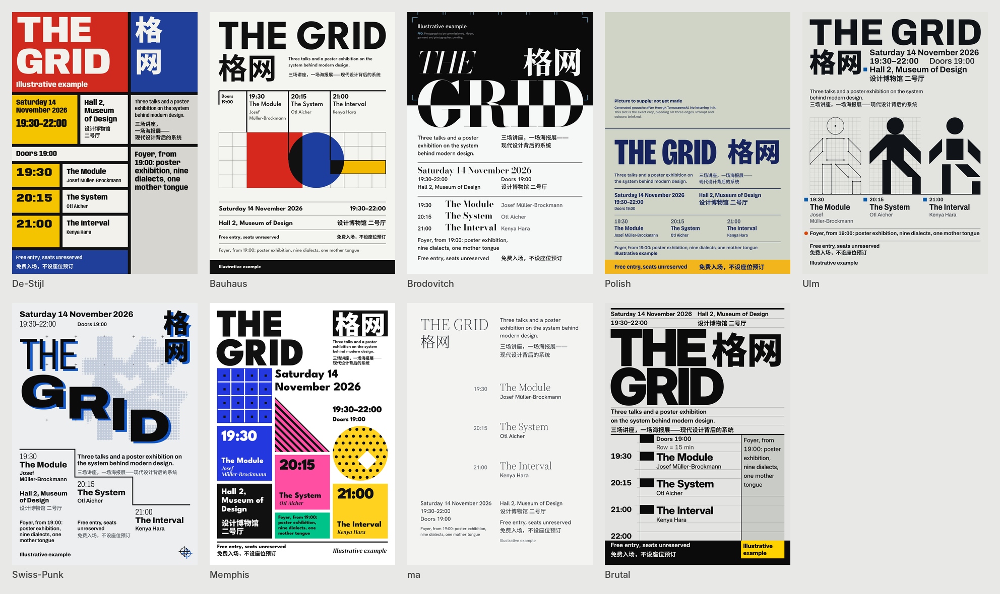

# Examples

Nine design systems, one per dialect. Each DESIGN.md stands alone: give it to any agent with your own content and format, and it carries the master's method, how a new subject yields its idea, the forms any content needs, and every size relative to the format. No skeleton holds content.

## Nine systems

| Folder | Hand | The system |
|---|---|---|
| `de-stijl/` | Mondrian, the compositions | Bars on the tracks; the content's measure sizes the planes |
| `bauhaus/` | Joost Schmidt, 1923 | A figure of the content built from circle, square and bar, hung from one thread |
| `brodovitch/` | The Bazaar covers | One photograph and one Didone word, cut by the same edge |
| `polish-poster/` | Henryk Tomaszewski | One hand-made ironic picture over quiet live facts |
| `ulm/` | Otl Aicher, Munich 1972 | A manual first: module, figures on one grid, colour as code |
| `swiss-punk/` | Wolfgang Weingart | Films slipped and overprinted by declared amounts |
| `memphis/` | Ettore Sottsass | Primitives clad in laminate, standing on slabs that carry the words |
| `ma/` | Kenya Hara, *White* | One whole interval; measures as equal white |
| `brutalist/` | The Construction hand | The content's measure becomes the row grid; one monolith |

## One programme, nine hands

Each folder also holds one poster for the same programme, The Grid, a museum's evening series on design systems: its content lives in `the-grid/brief.md`, never in the skeleton. The posters were made from an earlier, programme-bound version of each skeleton; the systems they show are unchanged.

## One skeleton, two makers

`series-ensemble-lumen/`: two concert posters from one skeleton. The second maker saw only the skeleton and its own brief.
