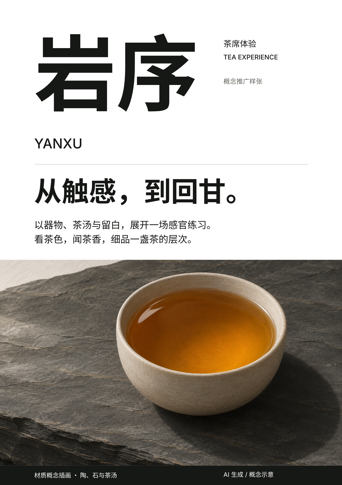

# Examples

The Swiss mother tongue and nine dialect systems. Each DESIGN.md stands alone: give it to any agent with your own content and format, and it carries the master's method, how a new subject yields its idea, the forms any content needs, and every size relative to the format. No skeleton holds content.

## Swiss mother tongue

[Swiss · 岩序 / YANXU](swiss/README.md): Müller-Brockmann's grid and reading relationships, without a dialect. A sixteen-page tea identity portfolio and an independently made illustrated A5 flyer share one [DESIGN.md](swiss/DESIGN.md). The example includes finished previews, the flyer's live HTML, image provenance, licensed font subsets and its exact input snapshot. It demonstrates transfer to another format, not average generation reliability. The earlier `yanxu-line-world/` path redirects here.

## Nine systems

| Folder | Hand | The system |
|---|---|---|
| `de-stijl/` | Mondrian, the compositions | Bars on the tracks; the content's measure sizes the planes |
| `bauhaus/` | Joost Schmidt, 1923 | A figure of the content built from circle, square and bar, hung from one thread |
| `brodovitch/` | The house campaign book, after the Bazaar covers | Black-and-white photographs, the subject's own colour, the figure cut against the word |
| `polish-poster/` | Henryk Tomaszewski | Two things the content joins, fused in one hand-made ironic picture over quiet live facts |
| `ulm/` | Otl Aicher, Munich 1972 | A manual first: module, figures on one grid, colour as code |
| `swiss-punk/` | Wolfgang Weingart | Films slipped and overprinted by declared amounts |
| `memphis/` | The tile system, after Sottsass and Du Pasquier | A kit drawn for the subject, tiled whole in clashing hues; type as a block |
| `ma/` | Kenya Hara, *White* | One whole interval; measures as equal white |
| `brutalist/` | The Construction hand | The content's measure becomes the row grid; one monolith |

## One programme, nine hands

Each folder also holds one poster for the same programme, The Grid, a museum's evening series on design systems: its content lives in `the-grid/brief.md`, never in the skeleton. The posters were made from an earlier, programme-bound version of each skeleton; the systems they show are unchanged, except Memphis, Brodovitch and Bauhaus, whose pieces predate their current systems.

## One skeleton, two makers

`series-ensemble-lumen/`: two concert posters from one skeleton. The second maker saw only the skeleton and its own brief.

`swiss/`: the portfolio's revised heavy/light typography, optical gaps and edge images were transferred to a portrait flyer by a maker given only the skeleton and new content. Its [input snapshot](swiss/flyer/proof/DESIGN-input.md) and [independent review](swiss/flyer/proof/independent-review.md) preserve the scope of that evidence. The earlier tasting sheet predates this revision. The [world review](swiss/REVIEW.md) records both, along with the line experiments and their limits.
