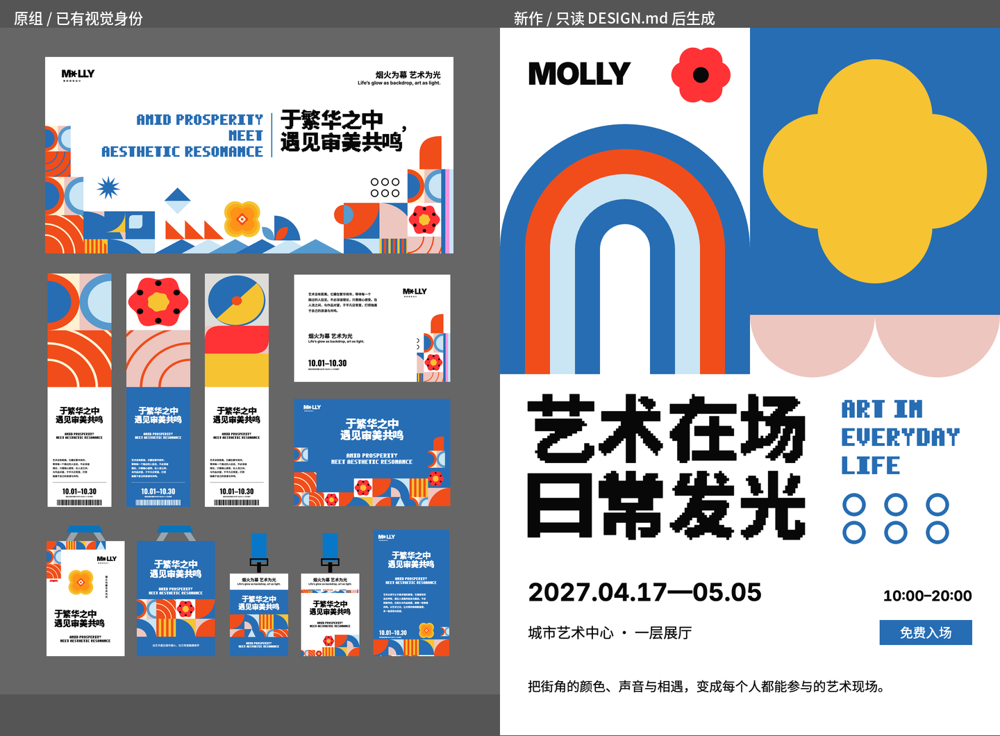

# 同一世界迁移验证：部分通过

问题：从未经改写的 `DESIGN.md`，能否独立生成另一件属于同一世界的作品？

**本次结果：新内容迁移与可读性通过，视觉身份只部分迁移。** 这份文件已经能传达配色与像素文字语言，但还没有把特征图形和模块构成写到足以独立重建的程度。

## 实验做了什么

- 选择第三组「模块景观身份」，只验证这一份文件。
- 把原 DESIGN.md 逐字复制到 [冻结输入](input/DESIGN.md)，没有先补规则。输入 SHA-256 为 `d7a5455e056e42ba929032d904a4248c47aa94b992685f4bf6a8d6ca9d5ddd40`。
- 给全新上下文的制作者一份[新简报](input/brief.md)：同一身份下另一场活动，主题改成「艺术在场 / 日常发光」，英文、日期、地点及正文全部换新，画幅为 1080×1528。
- 制作者仅获 DESIGN.md、简报和文件指名的字体素材，没有得到原图、旧成品、图形组件或原绘制代码。它自行构图、绘图、排字、渲染与自查；访问清单见 [制作者记录](frozen-v1/uncertainties.md)。这是任务约束形成的上下文隔离，不声称操作系统强制限制了文件访问。
- 自查完成后冻结 [SVG](frozen-v1/poster.svg) 与 [PNG](frozen-v1/poster.png)，再由三个独立上下文分别审查身份、结构、工艺。另一个独立上下文综合裁决。四个审阅者均未看 DESIGN.md、制作代码与制作解释。
- 评审后没有修饰新稿来争取通过。新作与输入的指纹分别保存在 frozen-v1-manifest.json 与 input-manifest.json。

字体素材是此实验的输入条件；因此这不是「不提供字体资产，只给纯文字文件」的实验。

## 独立裁决

| 维度 | 结果 | 可见证据 |
|---|---|---|
| 新内容重组 | 通过 | 新中文双行与英文三行重新并列，日期、时间、地点及正文另排；不是前作等比缩放换字 |
| 工艺与完整性 | 通过 | 9 项固定信息均可见，无错误遮挡或裁切；实际字体加载正常 |
| 文字身份 | 有明确亲缘 | 厚重的阶梯中文与像素英文延续原组语言 |
| 图形身份 | 部分通过 | 红花丢失黄心和外围六黑点，黄花失去多层内部构造 |
| 构成身份 | 部分通过 | 多种模块的拼接节奏变成两块巨大图形，交错轮廓和密疏变化较弱 |

裁决没有把「上图下文」本身判为错误，因为原组窄幅确实使用这种结构。问题在于模块尺度和拼接关系，而非新稿没有复制横幅的摆放。

独立审阅记录：[身份](evaluation/identity-review.md) · [结构](evaluation/structure-review.md) · [工艺](evaluation/craft-review.md) · [最终裁决](evaluation/judge-review.md)。[灰度对照](evaluation/comparison-v1-gray.png)中仍可见构成差异；结论不只依靠颜色或相同品牌名。

## 规则缺漏与执行选择分别在哪里

| 输入中的表述 | 制作者实际补出的决定 | 反推结果 |
|---|---|---|
| 「六瓣红花加黑点」 | 把黑点放成一个花心 | 方位、数量和黄心没有写清；原组最有识别度的构造丢失 |
| 「四圆瓣黄花」 | 画成实心黄色四瓣形 | 圆瓣这一外形保住了，黄橙叠层和中心细节没有传递 |
| 「同心弧」 | 画五层、带长直腿的巨大拱门 | 半径、裁切、圆心位置和能否延伸都未定义，出现了另一种图形语言 |
| 「竖幅可以先铺两个大模块」「窄幅大图占上方约49%」 | 在较宽的竖版海报上采用两大块上图下文 | 窄条与宽海报的条件没有区分；形式可迁移，尺度节奏却丢失 |
| 「保持参考的强度」「图形库先校正轮廓」 | 在没有参考的情况下自行判断 | 这些句子依赖被刻意拿走的图片，不能作为 Use alone 的独立指令 |

不能把每个坐标未规定都算作缺漏。新日期放在哪里、边距取多少、英文如何换行，这些应允许制作者决定；本轮也证明它能妥善处理。真正需要补的是决定身份的**图形构造、相对尺度、组合关系和适用条件**。

## 下一轮应改什么

优先改这份 DESIGN.md，不把本次问题直接扩成整个流派的新禁令：

1. 把红花、黄花和圆弧写成可独立构造的图形卡：圆心、瓣数、内外层、黑点数量与位置，以及相对半径；这些是身份规则，不是某件成品的坐标。
2. 区分窄条与宽竖版：说明哪些格式允许两块大图、哪些依靠多模块边缘景观。补模块大小相对短边的关系与重复/合并方式，再验证候选参数。
3. 把「保持参考」「校正轮廓」换成文件自身能表达的关系；缺少的标准字标作为明确素材声明，不能暗示仅写品牌名就能还原。

本轮没有据此改输入或重做新稿。若下一轮修改，应保留此样本，另开新的独立制作上下文、使用相同简报，以免把事后修图当作原规则的能力。

## 技术验证

- `factcheck.py`：9 facts，0 missing，0 warnings。
- Chrome 实际渲染：11 个活字文本元素、0 张嵌入位图、0 个文字盒越界、0 个字体加载错误、0 个页面脚本错误。
- 逐个文本元素经浏览器 CDP 读取实际字体：全部使用内嵌的 Folio Pixel Study、Inter 或 Noto Sans SC，未落到系统替代字库。
- 实际文字配对为黑/白、蓝/白、白/蓝。按画面实色底和实际字色计算，最小对比度为 **5.351:1**，均达到正文的 4.5:1。
- `folio-check.py DESIGN.md poster.svg` **没有全部通过**：保留了 4 个导出字体别名错误（Poster Pixel、Poster Sans、Poster Numerals、Poster Brand 未作为 token 名称出现）。浏览器实测证明它们指向已提供的正确字体文件；这是名称匹配问题，未修改检查器或伪称通过。

原始证据：[render-audit.json](frozen-v1/render-audit.json) · [technical-results.json](evaluation/technical-results.json)。

## 这一次能证明的边界

它证明这份冻结输入在一次独立制作中，支持了完整的新内容重组，并产生了部分可辨认的亲缘。它没有通过「完整保留同一视觉世界」的严格检验，也不能证明普遍可靠性或其余九份规则的能力。最有价值的失败信息是：之前从成品提取的文字仍像一份读图描述，尚未完全成为制作者不看图也能执行的系统。
