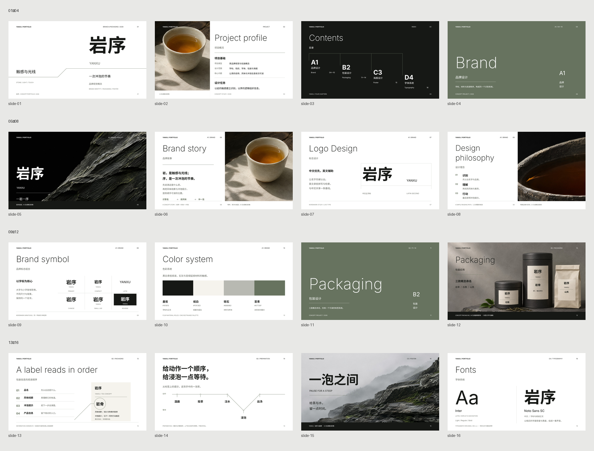
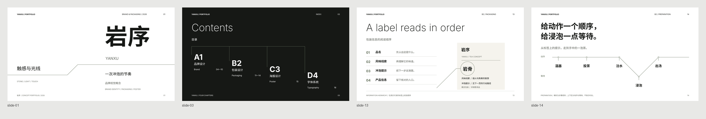
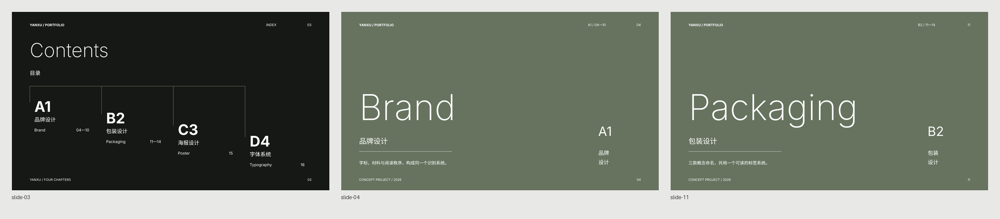

# Swiss · 岩序 / YANXU

Theme: Swiss mother tongue. Dialect: none. Governing hand: Josef Müller-Brockmann, the grid and reading relationships. A reference-led contemporary application of that method, not a historical reconstruction of his work.

The subject supplies the material and the order: identify the tea, understand its character, prepare it. The grid remains implicit; selective rules separate groups, while Link, Cut, Point and String carry particular relationships. Heavy Chinese identity and large light Latin headings give the portfolio its changes of voice. Dark stone, ceramic and amber tea provide the image vocabulary. Quiet space and tea do not by themselves make this a ma dialect.

## The world and its pieces

- [DESIGN.md](DESIGN.md): the standalone system. Content stays in each brief.
- [Portfolio brief](brand-portfolio/brief.md): sixteen read-alone landscape pages, reconstructed from the user's fifteen-page reference sequence, with one added preparation page.
- [Illustrated flyer](flyer/flyer.html) · [PNG](flyer/flyer.png) · [A5 PDF](flyer/flyer.pdf) · [brief](flyer/brief.md): a new portrait piece made from DESIGN alone. Text is live; the original material illustration is explicitly a generated concept.
- [Review record](REVIEW.md): actual repairs, independent reviews and the limits of the experiments.

The line page sequence is Link on 01, Cut on 03, Point on 13 and String on 14. Other pages use ordinary rules when a local boundary is all the reader needs. The flyer needs only one quiet boundary, so it does not repeat a leading line figure.

The current portfolio is revision 3: its contents resets navigation on charcoal; Brand and Packaging open on the same moss Accent field. All foreground roles reverse to white while the axes and large light type remain. These are turns at navigation and chapter boundaries, not an alternating page-color pattern. The earlier revision-2 contact and line views remain beside the current previews; the flyer predates this field extension.

## What the transfer establishes

The fresh flyer maker received only the world DESIGN, a new tea-experience brief and the permitted fonts. It did not see the portfolio, its source or Folio's other files. It generated a new illustration and recomposed the landscape world's relationships for A5. A separate reader reviewed the actual final image and PDF render. The immutable [input snapshot](flyer/proof/DESIGN-input.md), [maker brief](flyer/proof/maker-brief.md), [self-check](flyer/self-check.md) and [independent review](flyer/proof/independent-review.md) preserve that run.

This is one successful transfer. It does not establish automatic line retrieval, superiority to every reference, or repeatability across models. Subsequent wording changes to the world generalize export checks and clarify the existing material-image allowance; the snapshot remains the authority for what the maker actually read.

## Reuse

Give another maker DESIGN.md and a new brief, without these pictures, to test the world. For the fixed flyer, open its HTML with its adjacent `assets/` and `fonts/`. Font files are licensed glyph subsets for this specimen; new copy needs the full Inter and Noto Sans SC sources named in the font manifest. The PDF is a net A5 RGB concept proof; production bleed and printer profiles were not commissioned.

The full editable portfolio and generation records remain local under `exports/yanxu-line-world/`; the independent flyer's original delivery is under `exports/yanxu-design-only-flyer/`. They are excluded by the repository's existing output policy. The previous example path `examples/yanxu-line-world/` is retained as a symlink to this folder.
