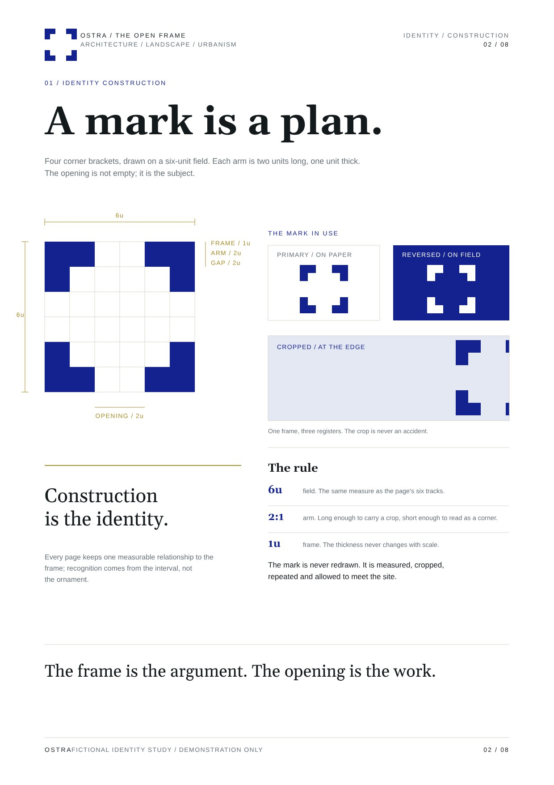
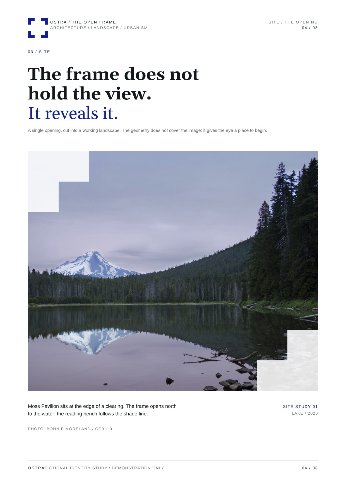

# One measure, two appearances

**Task:** give the fictional OSTRA architectural identity a coherent construction page and photographic application. These are demonstration pages, not an identity for a real client.

**Decision.** A six-unit bracket field, enlarged until its contour crops the photograph; the opening carries recognition, so the mark is never stamped on the image.

**Why.** One measured rule generates different compositions; remove the blue and the relationship still reads. Style as a constraint system.

**Transfer.** Carry one measurable relationship of the real identity (thickness, interval, join, negative space) into scale and crop; withhold the mark when its logic already carries the page.

**Limits.** Without distinctive source geometry it becomes arbitrary corner cutting; never invent a quasi-logo for a real brand. The construction footer collides with “OSTRA”; copy and photograph are illustrative.

**Source.** `ppt-master-themes`, Brand Geometry examples: [construction SVG](https://github.com/yeweigao/ppt-master-themes/blob/b67a6f0d663a278aca911434e3aa45aafdb916eb/themes/brand-geometry/examples/svg/02_identity.svg), [application SVG](https://github.com/yeweigao/ppt-master-themes/blob/b67a6f0d663a278aca911434e3aa45aafdb916eb/themes/brand-geometry/examples/svg/04_window.svg). Existing raster previews copied without alteration, under [Apache 2.0](../LICENSE-APACHE-2.0.txt). Photograph: Bonnie Moreland, [Lake Mountain Landscape](https://commons.wikimedia.org/wiki/File:Lake_Mountain_Landscape.jpg), CC0 1.0. Review covers these previews, not a reopened PPTX or a print proof.
