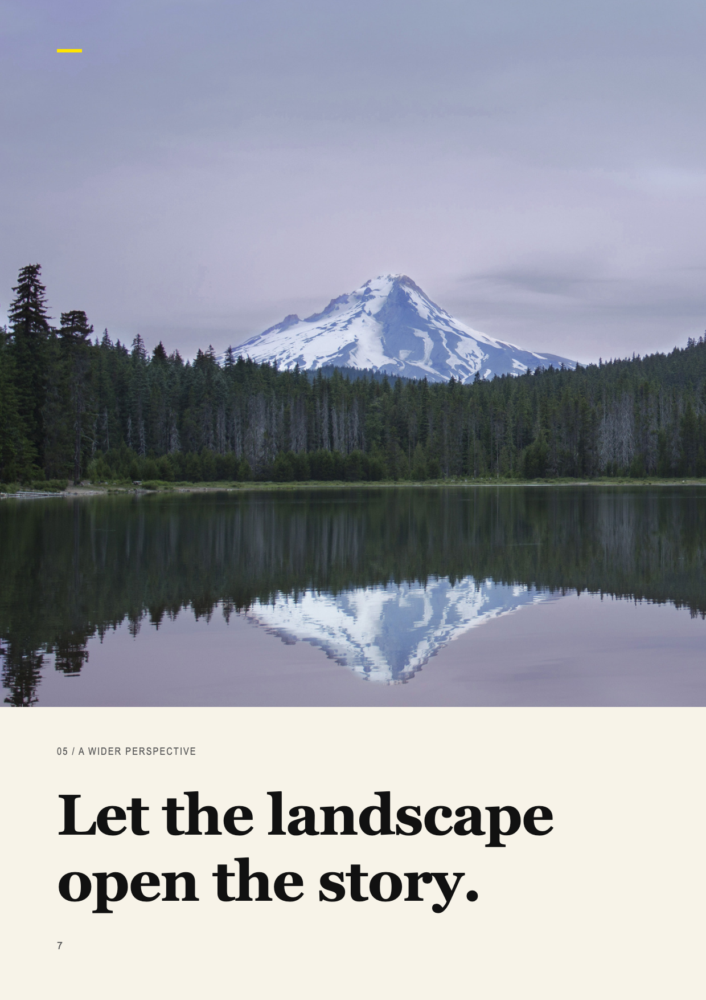
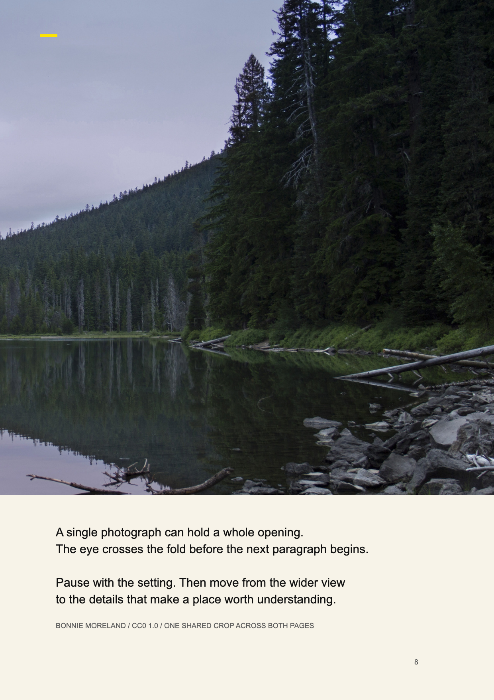

# One scene across a seam

**Task:** open a landscape sequence with a view wider than one page. Read the previews as a left/right pair; the repository calls the study “NatGeo,” but it is an original demonstration, not a National Geographic magazine reproduction.

| Left | Right |
|---|---|
|  |  |

**Decision.** One photograph on one spread coordinate system; the subject clear of the join, a shared image edge as the horizontal axis, a statement left and a quieter continuation right.

**Why.** The second page extends the scene instead of repeating a fitted photograph; unequal text roles give direction, the shared edge holds the pair.

**Transfer.** Compose the spread, then derive both crops; keep the subject clear of the binding; recompose when pages display singly.

**Limits.** Folios 7 and 8 would not face each other in a left-to-right binding: a composition study with a production defect. The yellow ticks explain nothing; do not inherit them.

**Source.** `ppt-master-themes`: [left SVG](https://github.com/yeweigao/ppt-master-themes/blob/b67a6f0d663a278aca911434e3aa45aafdb916eb/themes/natgeo/examples/svg/03e_content_spread_left.svg), [right SVG](https://github.com/yeweigao/ppt-master-themes/blob/b67a6f0d663a278aca911434e3aa45aafdb916eb/themes/natgeo/examples/svg/03f_content_spread_right.svg). Existing previews copied without alteration, under [Apache 2.0](../LICENSE-APACHE-2.0.txt). Photograph: Bonnie Moreland, [Lake Mountain Landscape](https://commons.wikimedia.org/wiki/File:Lake_Mountain_Landscape.jpg), CC0 1.0. Viewing these previews does not verify the exported document's page order or print production.
