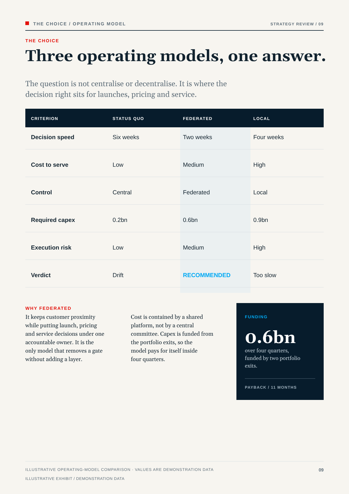
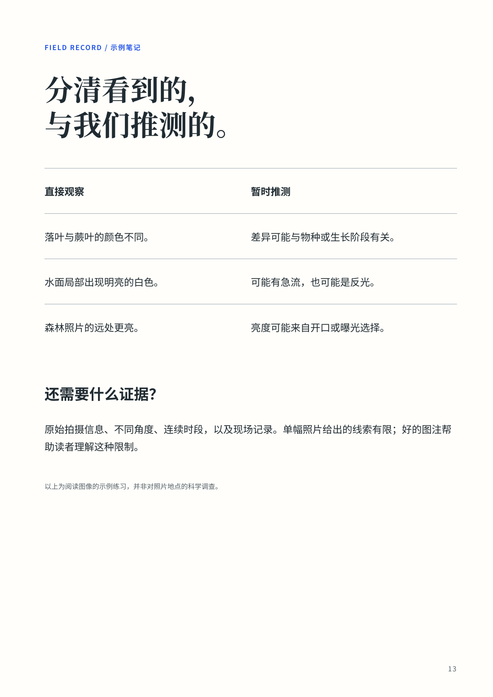

# Rows create relationships

**Task:** let a reader compare related statements without remembering the previous column. The two examples use a common device for different purposes: choosing an operating model and separating observation from inference.

**Decision table.** Criteria on a fixed left axis, alternatives on shared rows; reading across tests each difference, one tinted column gathers the recommendation. Separate cards would break the rows once copy lengths diverged.

**Observation exercise.** Peer columns, each inference beside its observation, no winning color; the closing question turns comparison into asking what evidence is missing. Few roles carry the hierarchy.

**Transfer.** Name the unit of comparison before the columns; pair items by row, let the longer set the height; emphasize a column only for a supported choice.

**Limits.** Close reading only, not projection; longer material needs a new density. The cyan “RECOMMENDED” fails contrast (about 2.3:1). Claims and quantities are illustrative.

**Sources.** Boardroom: [original SVG](https://github.com/yeweigao/ppt-master-themes/blob/b67a6f0d663a278aca911434e3aa45aafdb916eb/themes/boardroom/examples/svg/09_choice.svg), existing preview copied unchanged. Handbook: [Folio System source](https://github.com/yeweigao/handbook-designer-skill/blob/dc900cd0c9b50bfb8e30630d512dc5b218f01428/dev/samples/native/folio-system/book.html), page `p13`. **Excerpt reconstruction:** its original content and CSS were rendered with local Noto Serif SC / Noto Sans SC; unavailable Inter used the declared Noto Sans fallback. Bleed was removed for the trim preview. It is not a reproduction of an inspected original PDF. Both derive from the author's repositories under [Apache 2.0](../LICENSE-APACHE-2.0.txt); no external photographs or font files are included here.
